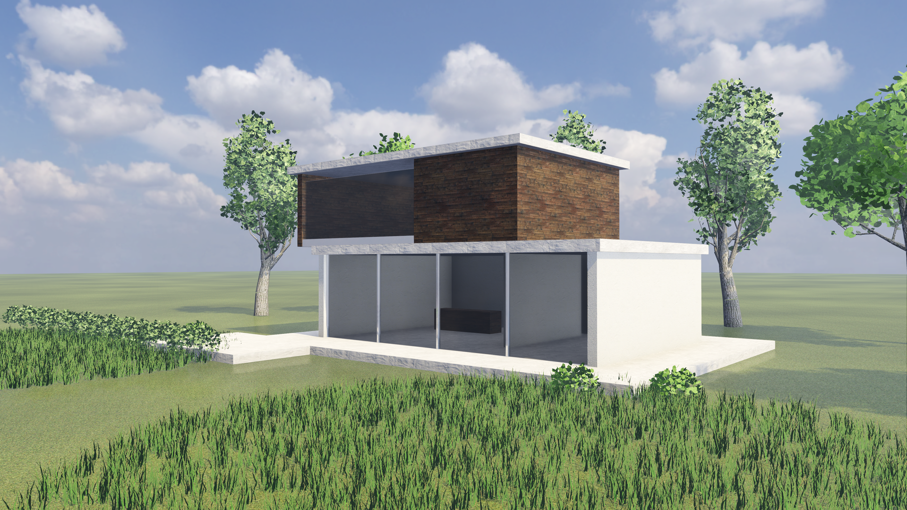
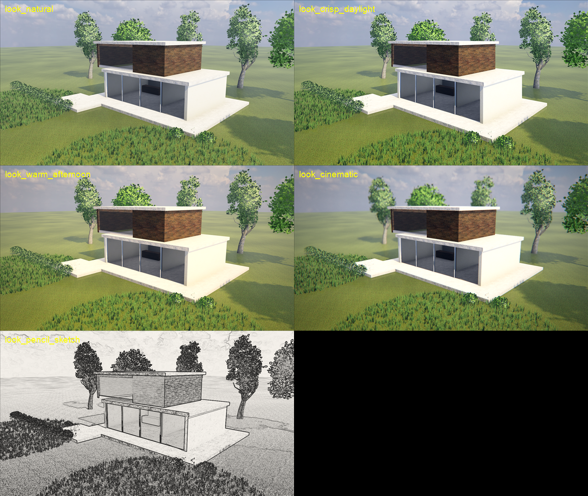
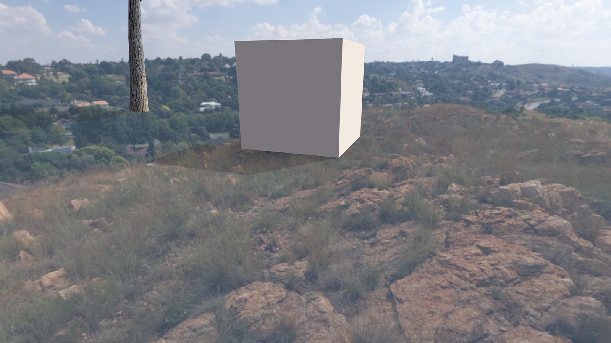
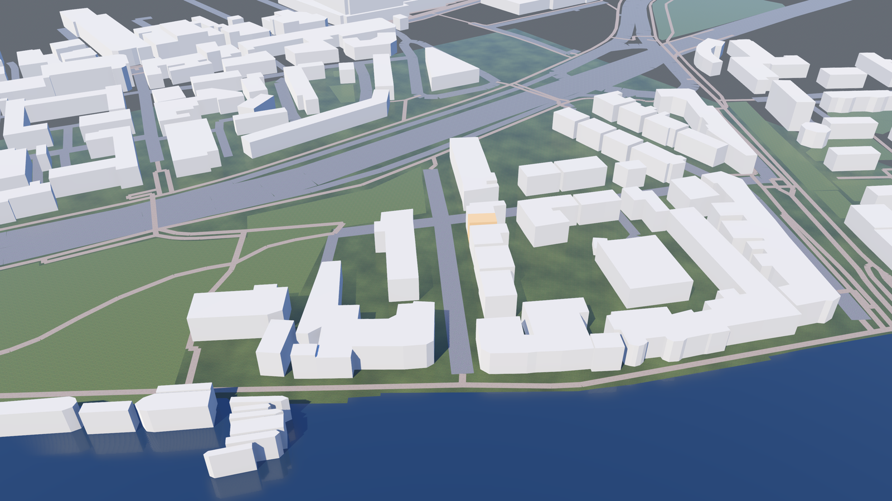
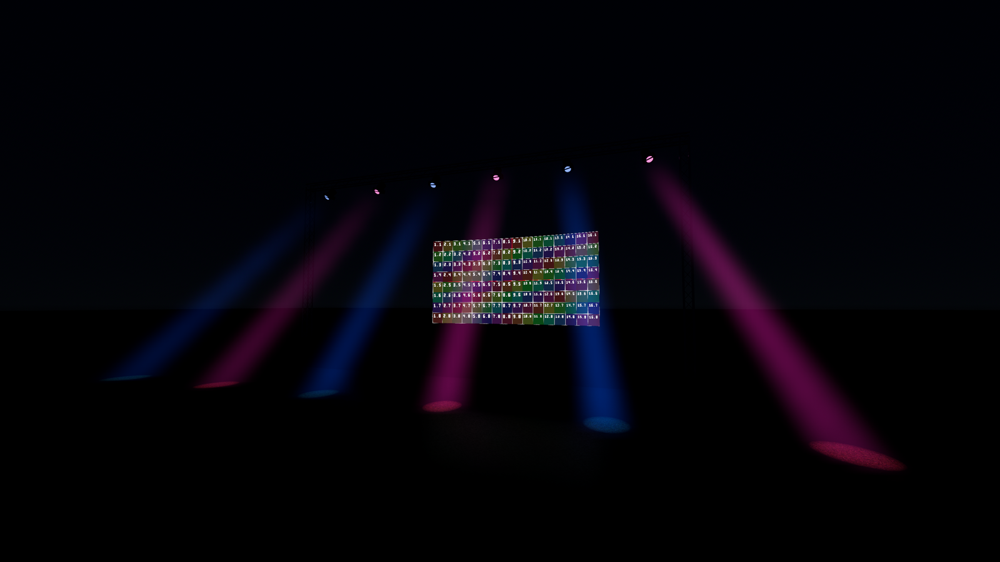
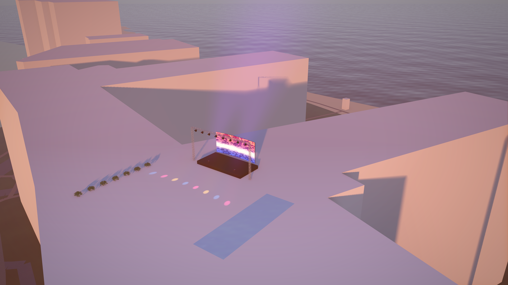
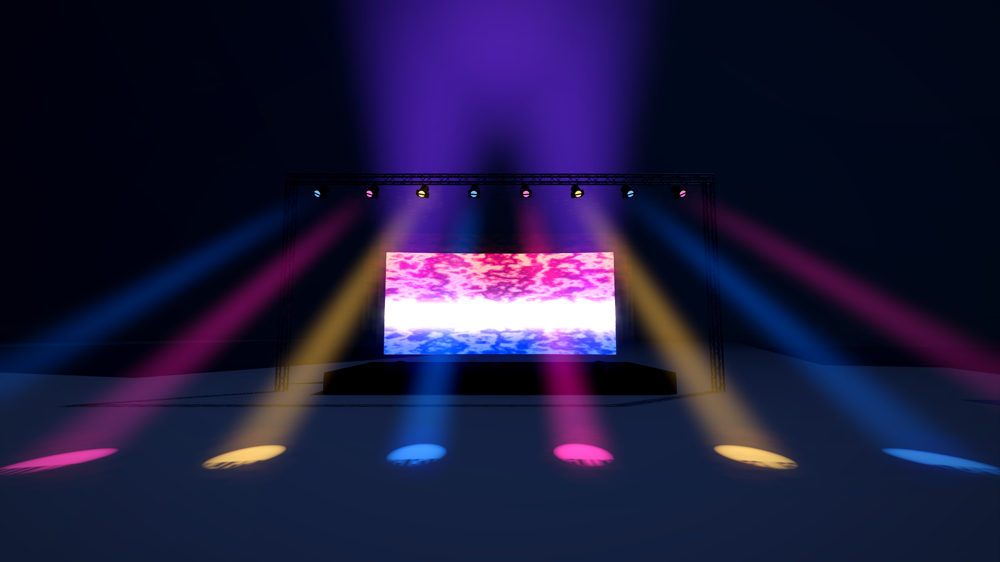
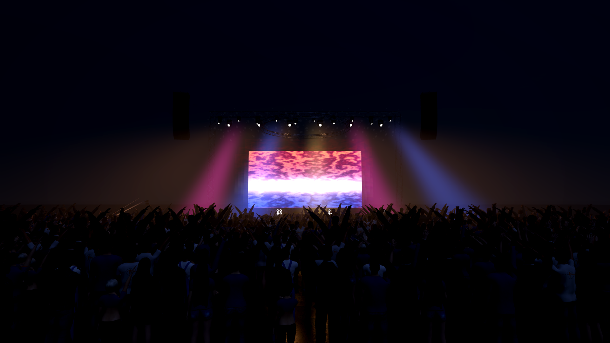
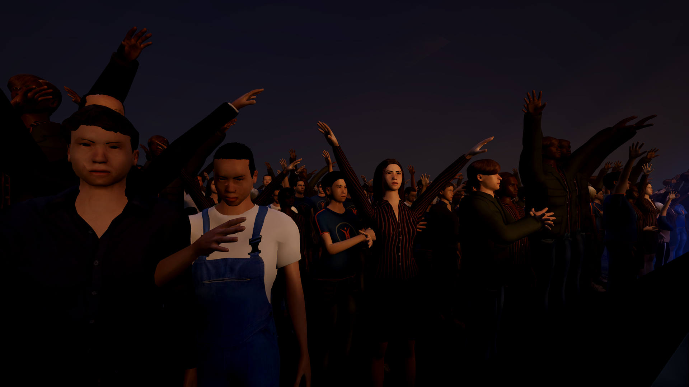

# Genesis

**Import your building. Make it beautiful.**

> **Work in progress.** Genesis is under active development and not yet released: expect
> rough edges, missing pieces and changes that break saved scenes. There are no release
> downloads yet; to try it, clone the repository and follow Getting started below.

Genesis is free, open architectural and event visualization built on the Godot engine. You
bring in a building, drop it into a real neighbourhood or a photo of the site, light it with a
photographed sky and the real sun, dress it with scanned materials and plants, stage it with
LED walls and lights, and get stills, fly-throughs and 360° panoramas out of it.

## Getting started (Windows)

1. Get **Godot 4.7** from [godotengine.org](https://godotengine.org). The standard build is
   fine; nothing to install, just unzip it.
2. Put it in `%USERPROFILE%\tools\godot\`, or set `GENESIS_GODOT` to the Godot executable.
3. Double-click **`Genesis.bat`**. The first time, it downloads the free photographic assets
   and builds the materials and plants (Python 3 needed, a few minutes, once).

The Genesis panel sits on the right of the Godot editor. Its sections are, roughly, the
order you work in.

| Section | What it does |
|---|---|
| **SCENE** | New scene in one click. Bring in a building (GLB, FBX, OBJ, or .blend with Blender); **live link** brings in each re-export automatically. **Site context:** type an address and the real neighbourhood arrives: OpenStreetMap buildings, roads and water on the real ground (open elevation data), under an aerial photograph. **Measure** by clicking two points; **layers** show and hide sets of objects. |
| **PLANS** | Build on the real drawings. A **floor plan** (image or PDF page) laid on the ground at true scale, set exactly with two clicks and a known distance. **CAD drawings** (DXF, a PDF plotted from CAD, or DWG through the free ODA File Converter) at true size, in their layers and colours, with their text, blocks and arcs; tick layers to show them, or to raise their lines as walls. The tape measure snaps to a drawing's corners and ends, to the millimetre. |
| **ASSETS** | A library of 54 plant species (broadleaf trees in every season, conifers, palms, hedges, topiary, flowers, grasses, potted plants), people, furniture and a full production kit (speakers, lighting fixtures, consoles, racks, DJ gear, cameras, projectors, screens, barriers, road cases, tents), each with its licence recorded. Click Place, or **place along a line**. |
| **ENVIRONMENT** | Time of day, sun direction, photographed skies, **real sun** for any place and date, haze, stage haze (makes light beams visible), exposure. |
| **LANDSCAPE** | Paint vegetation by dragging in the 3D view; Shift-drag erases. Can paint onto roofs and terrain. |
| **SET** | Event staging at real sizes: **LED walls** from panel specs (with power, weight, data and pixel-map reports), box, triangle, ladder and circle truss, stage decks, **flown line arrays** with real splay, a **flying screen** (an LED wall on a long line under a helicopter), moving heads that really pan and tilt, washes and downlights. **Crowds** of thousands at a set density, in a mood: concert, seated, milling about, or a frustrated queue. **Effects:** fire, smoke, fountains, falling leaves, confetti, CO2 jets, cold sparks, flame projectors. |
| **MATERIALS** | Select a building, pick a surface, click a scanned material: brick, concrete, plaster, wood, paving, stone, metal, glass. |
| **CAMERAS** | Save views, set the lens, cut the view open, make **plans, sections and elevations** in one click, and **photo match**: put the design into a photo of the real site, with its shadows on the photographed ground. |
| **LOOK** | Per-camera finishing: exposure, colour, warmth, depth of field, 2-point perspective, vignette, grain, pencil sketch. Eight built-in looks, plus your own. |
| **RENDER** | Stills up to 4K (supersampled), every camera at once, a sun study (9:00, 12:00, 15:00), and 360° panoramas. |
| **SHOW** | Run the event before it happens. **Live video** on the LED walls: Deckboy's Stream output (SRT), OBS or vMix, a window or display, a capture card, a video file. **Cues** record each look (lights, screens, effects, time of day, haze, camera); **GO** fades from one to the next, in a full-screen show view if you like, and can tell Deckboy (or anything that takes OSC) to go at the same moment. |
| **MOVIE** | Fly-throughs: glide through saved cameras or orbit the building, preview, render to MP4. It warns you if the camera would pass through a tree. **Time-lapse** sun, and **moving objects** (traffic, boats) along paths you draw. |

To start a separate project for a job: `python tools/new_project.py "C:/Projects/My Job"`.

## What's free about it

Everything. The code, and every asset it ships or downloads:
- **Skies and materials:** photographed and scanned, CC0 from [Poly Haven](https://polyhaven.com)
  and [ambientCG](https://ambientcg.com).
- **Plants:** built by Genesis from CC0 leaf and bark photographs.
- **Site context:** comes from OpenStreetMap, whose data is ODbL. Renders that show it should
  credit "© OpenStreetMap contributors".
- **AI upscaling:** [Real-ESRGAN](https://github.com/xinntao/Real-ESRGAN) (BSD-3-Clause), downloaded the
  first time it is used, with its licence kept beside it.

Every asset carries a `.license.json` saying where it came from.

## Honest limits

- **Assets:** Lumion ships more than 10,000; this has a few hundred, all generated or fully
  licensed. People are MakeHuman figures (real bodies, simple clothes): posed crowds, and walkers
  that stride along paths. Animals are modelled and posed, not animated.
- **Rendering:** no path tracer. Photoreal stills average many real-time renders (true lens
  blur, soft sun shadows, clean edges), but reflections and bounce light stay screen-space.
- **Views:** Godot doesn't let a plugin move the editor's camera, so a saved view is recalled
  by its live preview. Press F to frame a selection.
- **Site context:** buildings without a mapped height get a typical height for their type.
  Aerial photographs are sharpest in the United States (USGS); elsewhere they come from
  Sentinel-2 at about 10 m per pixel.

## For developers

- [ARCHITECTURE.md](ARCHITECTURE.md): how it's built, and what Godot provides vs what
  Genesis adds.
- Tests: `bash tests/run_all.sh` runs every suite (each opens a Godot window briefly).

## Screenshots

| | |
|---|---|
|  |  |
| Eight looks on one camera | A design composited into a real photographed field |
|  |  |
| Mall Road, Hammersmith, from OpenStreetMap, with the real sun | LED wall, truss and beams in haze |
|  |  |
| A rooftop concert on the 1 Hotel South Beach, Miami, with the neighbourhood and shoreline from OpenStreetMap, at golden hour on 5 December (map data © OpenStreetMap contributors) | The same show at 20:30, by moonlight |
|  |  |
| A concert built from the kit: 1,800 people, flown line arrays, moving heads, audience light | The audience from the photo pit |

## Licence

Genesis's code is released under the [MIT licence](LICENSE). The assets it ships or fetches
keep their own licences, recorded beside each one in its `.license.json`: most are CC0,
OpenStreetMap data is ODbL, and Real-ESRGAN is BSD-3-Clause.
